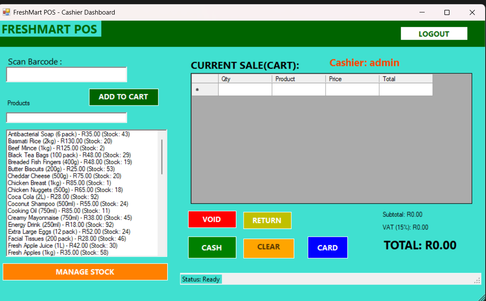
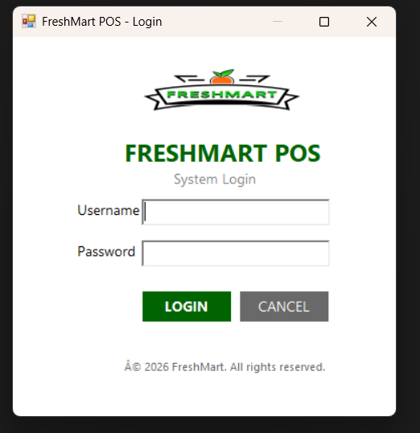
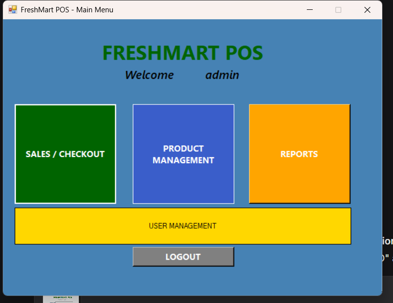
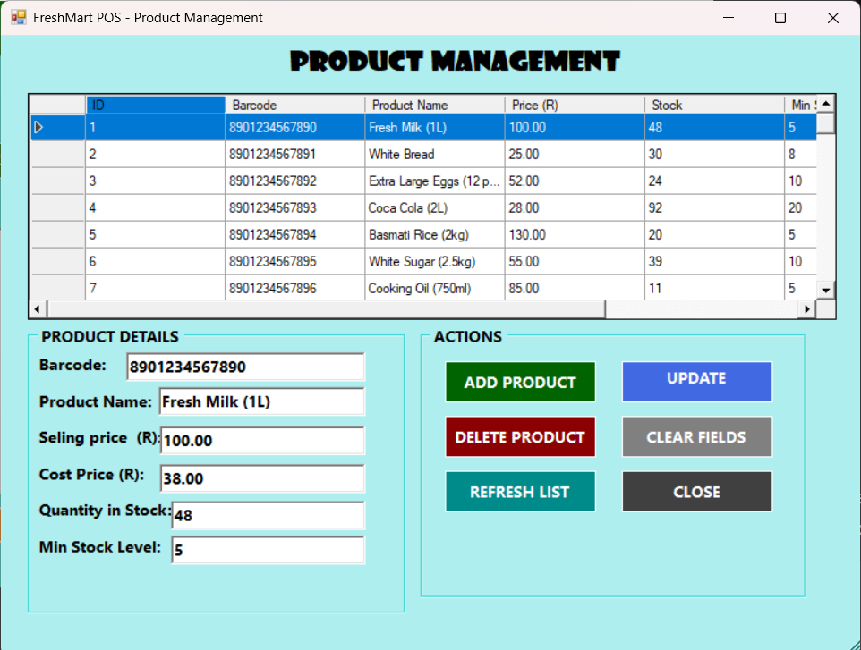
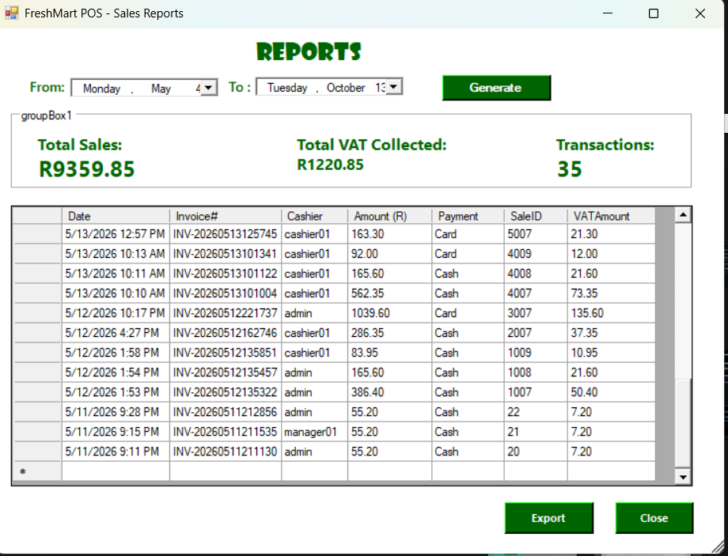

# FreshMart POS

A Windows Forms Point-of-Sale system for supermarket retail, built with **C++/CLI** on the **.NET Framework** and backed by **SQL Server LocalDB**. Handles sales, inventory, users, returns, and reporting in a single desktop application.

## Features

- **Role-based login** — Admin and Cashier roles with different permissions
- **Point of Sale** — Barcode scanning, cart management, void items, cash and card payment
- **Automatic VAT calculation** (15%) with live cart totals
- **Real-time stock updates** — inventory decreases as sales are processed
- **Product management** — add, update, and soft-delete products with duplicate prevention
- **User management** — create users, reset passwords, disable accounts
- **Returns processing** — with manager override required for refunds over R100
- **Low stock alerts** — warns when items drop below their minimum level
- **Sales reports** — filter by date range, view totals, export to CSV

## Screenshots

### Login

### Main Menu

### Product Management

### Sales Reports

## Tech Stack

| Layer | Technology |
|---|---|
| Language | C++/CLI |
| UI Framework | Windows Forms (.NET Framework) |
| Database | SQL Server LocalDB |
| Data Access | ADO.NET (`System::Data::SqlClient`) |
| IDE | Visual Studio |

## Architecture

The application follows a layered structure:

- **Forms** — UI layer (`LoginForm`, `MainMenuForm`, `CashierDashboard`, `ProductManagementForm`, `UserManagementForm`, `ReportsForm`, `ReturnForm`)
- **Domain classes** — Business entities (`User`, `Product`, `Sale`, `SaleItem`)
- **Database** — SQL Server LocalDB with tables for `Users`, `Products`, `Sales`, `SaleItems`, `Returns`

## Getting Started

### Prerequisites

- Windows 10/11
- Visual Studio 2022 (with the **C++ Desktop Development** workload)
- SQL Server LocalDB (installed with Visual Studio by default)

### Setup

1. Clone the repository: `git clone https://github.com/Nkieth79/SupermarketPOS.git`

2. Open `SupermarketPOS.slnx` in Visual Studio.

3. Build the solution: **Build → Build Solution** (`Ctrl+Shift+B`).

4. **Set up seed data.** The app reads two files from the executable's directory to populate the database on first run. Copy the example files and rename them:
   - Copy `users.txt.example` → `users.txt`
   - Copy `products.txt.example` → `products.txt`

   Edit them to add your own users and products. **Change the default passwords.**

5. Create the database in SQL Server LocalDB:
   - Open **SQL Server Object Explorer** in Visual Studio
   - Connect to `(localdb)\MSSQLLocalDB`
   - Create a new database named `SupermarketPOS`
   - Run `Database/CreateDatabase.sql` to create the tables

6. Run the application (`F5`).

## Project Structure

    SupermarketPOS/
    ├── images/                     # Screenshots used in this README
    ├── Database/                   # SQL schema script
    ├── *.cpp / *.h                 # Source files (forms and domain classes)
    ├── *.resx                      # Windows Forms resource files
    ├── SupermarketPOS.slnx         # Visual Studio solution
    ├── SupermarketPOS.vcxproj      # Project file
    ├── .gitignore
    └── README.md

## Notes

- The application uses SQL Server **LocalDB**, so no separate database server is required — it runs locally with the app.
- Database files (`*.mdf`, `*.ldf`) and credential files (`users.txt`) are intentionally excluded from version control.
- This project was built to demonstrate a complete end-to-end desktop application: UI design, business logic, data persistence, role-based access, and reporting.

## License

This project is provided for educational and portfolio purposes.
